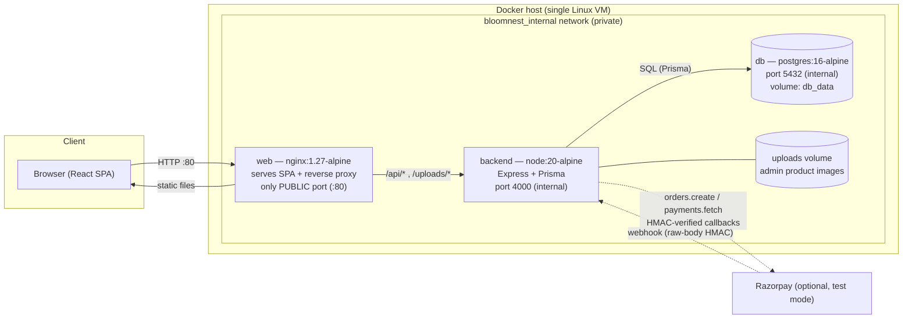
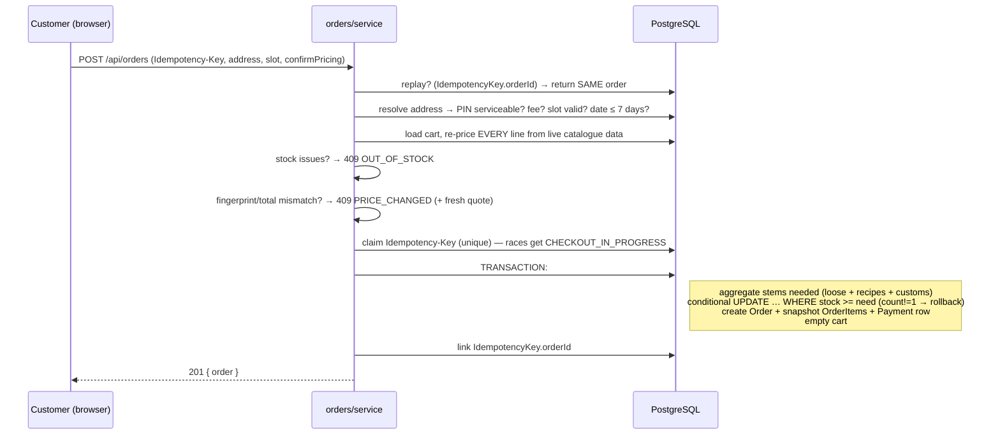
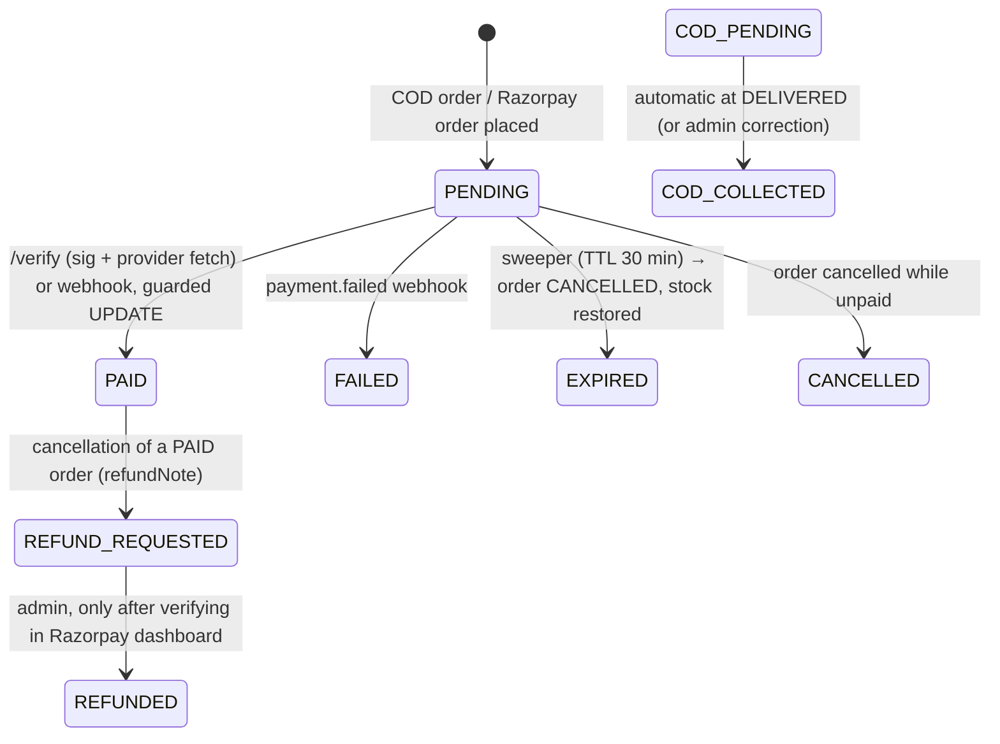
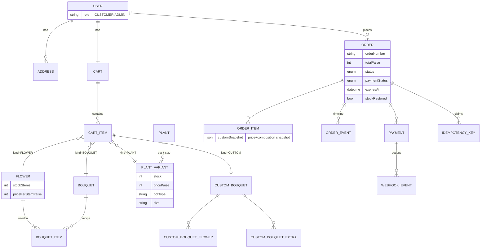

# BloomNest Architecture

## 1. System overview



Key points:

- **Only nginx is published.** The database and API live on the private `bloomnest_internal` bridge network and cannot be reached from outside the VM.
- The SPA calls **same-origin relative paths** (`/api/...`), so no CORS complexity and no keys in the bundle.
- State lives in **two named volumes**: `db_data` (PostgreSQL) and `uploads` (uploaded images) — both survive container recreation.

## 2. Backend module layout

```
src/
├─ config/env.ts        zod-validated environment (boot fails fast on bad config)
├─ lib/                 prisma client, JWT, validation schemas, image sniffing,
│                       order-number + fingerprint generators, AppError helpers
├─ middleware/          requireAuth / requireAdmin, rate limits, request logger,
│                       central JSON error handler (no stack leaks)
└─ modules/
   ├─ auth/             register (always CUSTOMER), login, logout, me
   ├─ catalog/          public reads + THE PRICING ENGINE (pure functions)
   ├─ cart/             persistent cart; every load is re-priced server-side
   ├─ orders/           checkout transaction, quotes, cancel, expiry sweeper
   ├─ payments/         Razorpay create/verify/webhook — all idempotent
   └─ admin/            stats, catalogue CRUD, uploads, fulfilment, refunds
```

The pricing engine (`modules/catalog/pricing.ts`) is **pure** — no database — so the live builder preview, the cart, and checkout all call the exact same function and can never disagree about a total.

## 3. The checkout transaction (the heart)



Guarantees:

1. **No overselling** — `UPDATE … SET stock = stock − n WHERE stock >= n` inside the transaction; the loser of the race gets 409 and a rollback.
2. **No duplicate orders** — the idempotency key is claimed before the transaction and linked to the order after; retries replay.
3. **No stale totals** — a cart fingerprint (SHA-256 over lines + server prices) must match; otherwise the client must confirm the fresh quote.
4. **History is immutable** — order lines store their own price + composition snapshots.

## 4. Payment state machine



- Payment status is a **separate column** from fulfilment status — they move independently.
- A late payment after cancellation is recorded as `LATE` + `PAYMENT_LATE` event; the order is **never revived**.
- Repeated verified callbacks/webhooks are absorbed by guarded transitions (`UPDATE … WHERE paymentStatus='PENDING'`) and the `WebhookEvent` dedup table.

## 5. Fulfilment timeline (strict sequence)

`PLACED → CONFIRMED → PREPARING → OUT_FOR_DELIVERY → DELIVERED`

The admin API enforces the exact next status (`INVALID_TRANSITION` otherwise). `DELIVERED` on a COD order automatically sets `COD_COLLECTED`. `CANCELLED` is reachable only from the first three stages and restores stock exactly once.

## 6. Database model (main relationships)



22 tables total. Notable choices:

- **Stock lives at the leaf**: `Flower.stockStems` (per stem) and `PlantVariant.stock` (per pot/size). Bouquets own no stock — they consume recipe stems, so availability is always computed.
- `CustomBouquet` is a real entity (1:1 with a cart item) so the builder can be edited later.
- `OrderItem.customSnapshot` (JSON) freezes exactly what the customer configured and what it cost.
- `WebhookEvent.eventId` unique + `IdempotencyKey(userId,key)` unique + `Payment.rzpPaymentId` unique give idempotency at three layers.

## 7. Frontend structure

- `src/api/client.ts` — one fetch wrapper (credentials: include, typed, `ApiError` with server codes).
- Contexts: `AuthContext` (session), `ToastContext` (feedback).
- Pages: Home, Catalog (flowers/bouquets/plants share one filterable page), Product, **Builder** (live 2D SVG preview + server-priced bill), Cart, Checkout, Login/Register, Orders, Order detail (timeline + cancel + pay-now), Admin (dashboard/products/orders/settings).
- Loading, empty, error and success states everywhere; mobile-first Tailwind layout.

## 8. Deliberate simplifications (single-VM)

- Sessions are stateless JWTs in a cookie — no session store needed; logout clears the cookie (documented trade-off).
- Rate limiting is in-memory — correct for one backend instance; Redis would be the next step.
- The expiry sweeper runs inside the backend (60 s interval) — on multiple instances you'd move it to one worker/cron.
