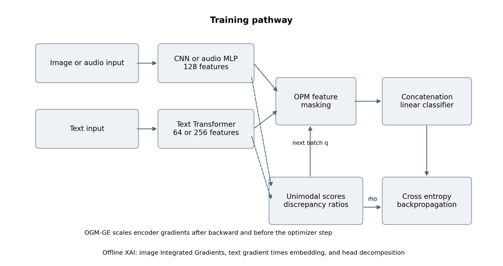
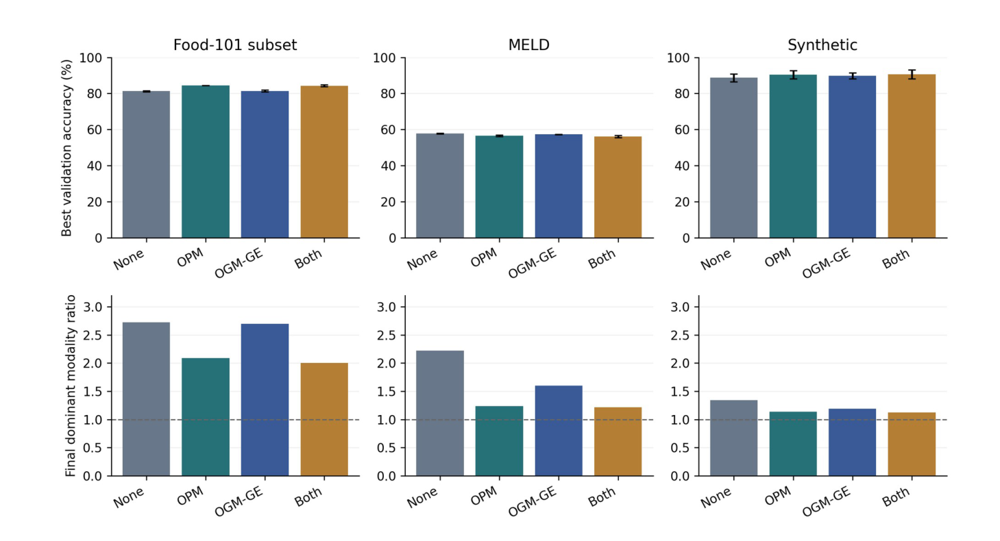
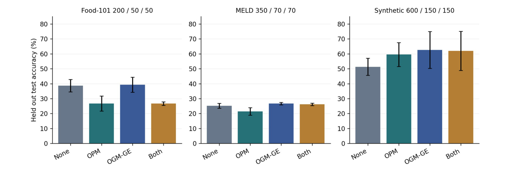
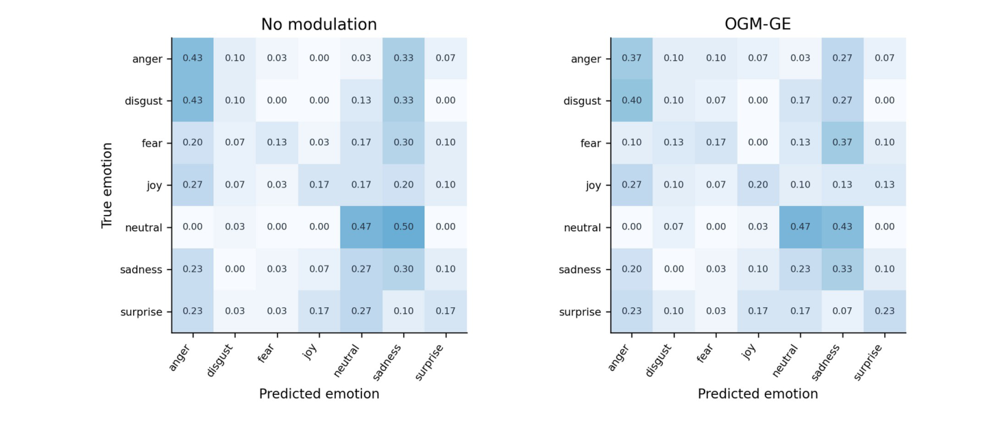

# XAI Driven Modality Bias Detection and Mitigation in Multimodal Deep Learning Models

**Nishant (I24AI028)**

Project team: I24AI001   I24AI009   I24AI026   I24AI028

Sardar Vallabhbhai National Institute of Technology, Surat

Integrated Artificial Intelligence Program — Deep Learning Semester Project

13 October 2026

---

## Abstract

A multimodal classifier can post a good accuracy number while quietly learning to lean on one input channel and ignore the other. Nobody sees it in the headline metric. This project is about that gap: how to see it, how to measure it, and whether training-time interventions actually close it. We built two things. One is a short PaliGemma demonstration that visualises attention over image patches. The other, and the substantive part, is a PyTorch late-fusion framework for image-text and audio-text classification, where each modality's true-class confidence is measured, converted into a discrepancy ratio, and used to drive On-the-fly Prediction Modulation (OPM), On-the-fly Gradient Modulation with Generalization Enhancement (OGM-GE), or both at once. Diagnostics come from image Integrated Gradients, gradient-times-embedding attribution for text, and an exact decomposition that holds for the linear head.

Three saved experimental protocols are analysed separately rather than pooled: an earlier three-seed validation benchmark, a single-seed live-demo pipeline, and a matched comparison of twelve learning strategies across three datasets and three seeds. The outcomes are mixed. We report them that way. On a Food-101 subset, OPM raises mean best validation accuracy from 81.23% to 84.47% while the final text discrepancy ratio falls from 2.726 to 2.085. On MELD the same kind of intervention moves the ratio from 2.219 to 1.219 but drops validation accuracy from 57.80% to 56.09%. In the matched five-epoch study, OGM-GE reaches test accuracies of 39.33%, 26.67% and 62.67% on the small Food-101, MELD and synthetic splits.

What these numbers support is a task-dependent trade-off between balance and accuracy. Read that narrowly. What they do not support is any claim of universal superiority, full-dataset performance, or mitigation taking place inside PaliGemma. That distinction carries most of the weight in what follows. The contribution is an inspectable implementation plus an empirical account of existing modulation methods, with explanation, optimisation and experimental scope kept explicitly apart — three layers, three sets of caveats.

**Keywords:** multimodal learning; modality imbalance; explainable artificial intelligence; Integrated Gradients; OPM; OGM-GE; late fusion; MELD.

---

## 1 Introduction

Some information exists in only one place. A photograph of a plate shows colour, texture and plating; the caption beside it supplies the name of the dish, which pixels alone may never reveal. Conversational emotion recognition splits the same way — the words carry semantic content, while an audio representation picks up vocal cues that the transcript loses. Combining the two should help. In practice a joint objective over two encoders guarantees no such thing, and one encoder can end up learning almost nothing useful while the reported accuracy stays high. The tension is easy to state and hard to measure.

The usual failure mode is early dominance. One branch produces a discriminative signal within the first few epochs, the fused classifier starts assigning the correct class a high probability on the strength of that branch alone, the cross-entropy residual for the other branch shrinks to almost nothing, and from that point on the weaker encoder is being trained on the leftovers of a loss it can no longer influence in any meaningful way. Training continues. Learning does not. Whatever the weaker encoder picks up after that point comes from a weak signal. This is the pattern the whole project keeps returning to. Peng et al. [1] frame this as an optimisation imbalance and slow the dominant branch's gradient. Wei et al. [2] push the same idea into the forward pass by masking dominant features with a discrepancy-dependent probability. Our training controller is built on both.

The question we actually wanted answered is narrower than "does balancing work". It is whether reducing a measurable modality discrepancy improves prediction quality under the data and model configurations this project could afford. A second question sits beside it: can explanation tools describe what an individual prediction relied on? These need different measurements and should not be conflated. A confidence ratio says something about relative discrimination. An attribution says something about a score's sensitivity to its inputs. Held-out accuracy and F1 say something about the task. Mixing them up is easy.

The codebase splits accordingly. A notebook loads pretrained PaliGemma and visualises attention over image patches; a separate package, `balanced_mm`, trains compact classifiers with explicit modality encoders and a late-fusion head, and that package is where OPM and OGM-GE live. The boundary matters, so we state it plainly: the PaliGemma notebook does not demonstrate OPM/OGM training, does not implement a learned Balanced Modal Attention layer, and does not include completed VQA fine-tuning. It is a demonstration, not an experiment.

So the paper describes an architecture, a controller, and an analysis of run evidence that already existed — favourable results and awkward ones side by side. Nothing was cherry-picked afterwards. Three things are contributed: diagnostic utilities wired into published modulation algorithms, a like-for-like comparison against several alternative learning strategies, and a reproducibility pass over the saved experiments. OPM, OGM and Integrated Gradients belong to their original authors. Nothing here is offered as a new optimisation algorithm.

## 2 Background and Related Work

### 2.1 Modality dominance and representation quality

By modality dominance we mean the persistent use of one input channel more heavily than another. Informative shortcuts, mismatched encoder capacities, different learning speeds, unequal signal quality and plain bad luck in initialisation can all produce it, and in a real run several of them usually arrive together. Dominance is not automatically a defect, though. For a given utterance, audio may genuinely carry less task-relevant information than text. The thing worth worrying about is avoidable under-optimisation, or a fragile reliance on a shortcut that will not survive a change of setting. Equal contributions are therefore a useful diagnostic reference point, not a universal objective to be optimised toward.

The gradient method of [1] watches relative modality contributions during training and slows the dominant branch. The later prediction-modulation method of [2] masks dominant modality features with a probability set by the discrepancy. Both are implemented here, separately and together. Context decides which one helps. Forward masking and backward scaling are different mechanisms, and they can land on different task outcomes even when they reduce the same confidence ratio.

### 2.2 Explainability and attribution

Integrated Gradients attributes a chosen prediction score along a path from a reference input to the observed input [3]. In our implementation it is applied to image pixels with the text branch held fixed. Text importance is measured differently, by gradient-times-embedding, which is a separate method and not an Integrated Gradients variant. Both figures describe the selected model score. Neither is a causal probability that a modality produced the answer. That distinction is not cosmetic.

Attention shows where weight is placed. The leap from "weighted position" to "important input" is a separate claim, and Jain and Wallace [4] show why it is unsafe for neural language models. So we treat the PaliGemma heatmap as a visualisation of one inspected attention tensor and nothing more. Modality removal, altered prompts and gradient-based attribution are the checks that belong alongside it.

### 2.3 Vision-language models and conversational data

PaliGemma pairs a SigLIP vision encoder with a Gemma language model and is designed for transfer to vision-language tasks [5]. Visual representations are projected into the language model's input space. That is a different architecture from our classifier, which concatenates separately pooled features. The modulation equations derived for the classifier do not transfer unchanged to arbitrary PaliGemma attention layers, and we make no attempt to do so. That gap is deliberate.

Food-101 provides 101 categories and 101,000 images [6], with no natural text modality — so this project constructs prompts from labels, which gives a controlled shortcut setting rather than a realistic captioning one. MELD supplies conversational utterances from *Friends* with text, audio and visual modalities [7]. The evaluated MELD model uses text plus the released audio features over seven emotion labels. It never touches MELD video frames and does not model dialogue-level context.

## 3 Study Scope and Data

### 3.1 Implemented components

The analysed snapshot is commit `56e981a` of `Nishant21092004/DL_project` [8]. Inside it are encoder definitions, data preparation, training hooks, evaluation metrics, explanation utilities, experiment runners and report generators. Table 1 draws the line between what is finished and what belonged to the original proposal's extensions. That line is what determines which claims the experiments can carry. Scope first, numbers second.

**Table 1. Implementation scope in the analysed source snapshot.**

| Component | Current scope |
|---|---|
| PaliGemma attention | Pretrained generation and image attention heatmap demonstration |
| Compact multimodal models | Image-text and audio-text late-fusion classification |
| Training modulation | OPM, OGM-GE, combined mode, and unmodulated controls |
| Explanation utilities | Image IG, text gradient-times-embedding, linear-head decomposition |
| Earlier learning strategies | GBlending, ModDrop, dropout variants, and Greedy with MMTM adaptations |
| Balanced Modal Attention | Proposal and future work; not an evaluated learned layer |
| PaliGemma fine-tuning and VQA | Not established by the classification experiments |

### 3.2 Synthetic image and text data

The synthetic generator works over six classes. Each image holds Gaussian noise plus, with probability 0.7, a class-dependent coloured patch at a class-dependent grid position. Text holds random tokens plus, with probability 0.7, a class-specific keyword. Informative events are drawn per sample, and training and evaluation use separate random streams. A synonym parameter increases the pool of interchangeable class keywords, which makes the text task harder on demand.

This buys us controlled complementary cues without downloading anything. It also makes the task easier than most natural ones, since labels and cues are structured by construction. Results from this generator establish behaviour under the generator, full stop. Useful, and limited. They say nothing about open-world vision-language reasoning.

### 3.3 Food-101 with label-derived prompts

The Food-101 experiment uses ten classes: pizza, sushi, hamburger, french fries, ice cream, chocolate cake, ramen, tacos, fried rice and caesar salad. With configured probability 0.7 the prompt names the correct class; otherwise it carries a generic food description. The default older preparation script samples 250 training and 100 evaluation images per class, and its `val.csv` is drawn from the original Food-101 test split. Read that carefully: the older result is a development/validation score on a selected subset, not a final test score backed by an untouched test set.

The committed live-demo archive is smaller still — 200 training, 50 validation and 50 test examples. In that newer protocol validation comes from the original training split and the original test split stays held out. Images in the small archive have a maximum side of 96 pixels; the compact CNN applies its own 64-pixel transforms. Text comes straight from the target label. We keep that design deliberately, because shortcut reliance is the object of study, but it has to be disclosed every time the classification scores are quoted.

### 3.4 MELD text and audio features

A MELD input is an utterance's text plus one 300-dimensional released audio feature vector. Full-data preparation supports 9,989 training, 1,109 validation and 2,610 test utterances. The small committed archive takes 50/10/10 examples from each of anger, disgust, fear, joy, neutral, sadness and surprise, which gives splits of 350, 70 and 70. That balanced sample has a class distribution quite unlike the complete dataset.

The pipeline joins text and audio features on dialogue and utterance identifiers, stores the vectors as NPZ files, and keeps split and source identifiers in CSV records so that any evaluated row can be traced back to the utterance it came from. Nothing exotic, and nothing hidden. Official split boundaries survive in the newer sample. Each utterance is classified independently, so relations across turns and speakers are outside the evaluated model.

## 4 Methodology

### 4.1 Encoders and fusion

Every modality gets its own encoder. SmallCNN has four convolution blocks with batch normalisation, ReLU and max pooling, then global average pooling down to 128 features. ResNet-18 exists as a 512-feature alternative. Every compact run reported here uses SmallCNN anyway. The audio branch is an MLP: 300-dimensional input, 256-dimensional hidden layer, layer normalisation, ReLU, dropout, 128-dimensional output.

Text goes through learned token and position embeddings, Transformer encoder layers, layer normalisation, and masked mean pooling. The earlier benchmark uses a 256-dimensional two-layer Transformer; the matched five-epoch experiment uses a 64-dimensional single-layer one. A word tokenizer is fitted on training text, validation and test text reuse the fitted vocabulary and saved label mapping, and any token the vocabulary has never seen is handled by the same fallback path in every run so that a difference between methods cannot come from vocabulary drift. Pretrained text encoders exist in the code as an option. None of the numbers below needs them. They stay switched off.

Let φ<sub>m</sub> be the feature of modality *m* and split the linear classifier's weight matrix into modality blocks. The fused logit vector is then the sum of weighted feature contributions plus one shared bias. With *M* modalities that bias can be divided equally among the unimodal contributions, and their sum reproduces the fused logits exactly.

> f(x) = W<sub>1</sub>φ<sub>1</sub> + … + W<sub>M</sub>φ<sub>M</sub> + b,   u<sub>m</sub> = W<sub>m</sub>φ<sub>m</sub> + b/M   (1)



**Figure 1.** Compact-model training architecture. Discrepancy is measured on unmasked features. OPM acts on the forward pass, while OGM-GE modifies encoder gradients after backpropagation. XAI is a separate diagnostic pathway, and the fusion head is never gradient-modulated.

### 4.2 Why a shared objective can under-optimise a modality

Take a labelled example. Cross-entropy is the negative log probability assigned to the correct class, and its derivative with respect to the class logit is the predicted probability minus the one-hot target. Chaining that through the fusion gives the encoder's learning signal in Equation 2.

> L = −log p<sub>y</sub>,   ∂L/∂f<sub>c</sub> = p<sub>c</sub> − 1[c = y],   ∂L/∂φ<sub>m</sub> = W<sub>m</sub><sup>T</sup>(p − e<sub>y</sub>)   (2)

Now suppose one branch already drives the fused correct-class probability close to one. The residual in Equation 2 can collapse long before the other branch has learned a robust representation. That is a mechanism, not a verdict. Signal quality, augmentation, model capacity and initialisation all feed into the same gradients, which is exactly why a modulation method has to be judged on task metrics and not on ratio reduction alone.

### 4.3 Discrepancy monitoring

For a training batch *B*, the controller takes a softmax over each modality's isolated logit vector and picks out the true-class probability. Those probabilities are summed across the batch and the modality totals are compared. Above two modalities, it averages the pairwise ratios against the remaining branches.

> s<sub>i,m</sub> = softmax(u<sub>i,m</sub>)[y<sub>i</sub>],   S<sub>m</sub> = Σ<sub>i</sub> s<sub>i,m</sub>,   ρ<sub>m</sub> = (1/(M−1)) Σ<sub>j≠m</sub> S<sub>m</sub> / (S<sub>j</sub> + ε)   (3)

The first sum runs over batch examples, the second over every *j* different from *m*. Epsilon is 1e-8 for numerical stability. A ratio above one marks the relatively more discriminative modality for that batch. With two modalities the ratios are near-reciprocal inside a batch, though separately averaged ratios across many batches need not stay exact reciprocals.

Keep the definition in mind. This quantity uses the known label, so it is a training and evaluation statistic — not an attention fraction, and not a protected-group fairness measure. For a nonlinear fusion head the software recovers unimodal proxy logits by keeping one feature branch and zeroing the others. The exact additive reading applies only to the linear head.

### 4.4 On-the-fly prediction modulation

OPM masks the entire feature vector of a dominant modality for a given sample, at random, while keeping weak modalities available. Masking probability rises with discrepancy through a hyperbolic-tangent response. Project defaults are q<sub>base</sub> = 0.5 and λ = 0.5.

> q<sub>m,t+1</sub> = q<sub>base</sub>[1 + λ tanh(ρ<sub>m,t</sub> − 1)]  when ρ<sub>m,t</sub> > 1   (4)

If the ratio is at most one the probability is zero, and in practice most batches early in training sit on that side of the boundary. Probabilities are clamped to the configured range, masking starts from zero, and batch *t* uses the current q<sub>t</sub> while q<sub>t+1</sub> is updated from that batch's own unmasked features. A safety check stops every modality of a sample from being removed. Kept features are not rescaled by default. At evaluation time nothing is masked: all available branches are used, as they are.

### 4.5 Gradient modulation and Gaussian enhancement

OGM scales down the dominant encoder's gradient by a coefficient read off the same discrepancy; default α is 0.5, and a non-dominant branch receives coefficient one. The scaling happens after backward — and after unscaling when mixed precision is in use — but before clipping and the optimiser step.

> k<sub>m</sub> = 1 − α tanh(ρ<sub>m</sub> − 1)  when ρ<sub>m</sub> > 1,   g<sub>m</sub> ← k<sub>m</sub>g<sub>m</sub> + h<sub>m</sub>   (5)

For the Generalization Enhancement term h<sub>m</sub>, the code samples independent Gaussian noise for eligible parameter tensors, with standard deviation taken from that tensor's unmodulated gradient and an epsilon guard. By default noise goes to weight tensors of at least two dimensions, across all modality encoders. This is a practical tensor-level approximation, not an estimate of the full SGD noise covariance. Only encoder parameters are modulated. The shared classifier trains normally.

Combined mode runs OPM forward and OGM-GE after backward. The controller can also confine modulation to an epoch window, or switch Gaussian enhancement off. Neither switch is used in the results below; they exist to support ablations, which is a different thing from those ablations having been run.

### 4.6 Explanation diagnostics

Image Integrated Gradients follows a straight path from a zero-valued reference to the input, with other modalities fixed. Gradients are evaluated at K+1 evenly spaced endpoints and their average is multiplied by the input-reference difference. One subtlety is easy to miss. The zero reference sits in the model's input representation, so after normalisation it need not correspond to a black RGB image.

> IG<sub>j</sub> ≈ (x<sub>j</sub> − x′<sub>j</sub>) · (1/(K+1)) Σ<sub>k=0..K</sub> ∂F(x′ + α(x − x′))/∂x<sub>j</sub>   (6)

Here α = k/K and F is the selected class logit. Text relevance works differently: multiply each embedding coordinate by its score gradient, sum across embedding coordinates, then zero the padded positions. Absolute image and token scores are summed and normalised into diagnostic modality shares.

> R<sub>l</sub> = Σ<sub>d</sub> (∂F/∂E<sub>l,d</sub>) E<sub>l,d</sub>,   a<sub>m</sub> = A<sub>m</sub> / Σ<sub>j</sub> A<sub>j</sub>   (7)

A<sub>m</sub> is the aggregate absolute attribution for a modality. These shares depend on baseline choice, score choice, feature scaling, and on using different attribution methods for different branches, so treat them as relative rather than absolute. The current `modality_attribution` utility covers image and text; the audio branch has none. Audio is simply absent from this diagnostic, and no audio attribution improvement should be inferred from the MELD confidence ratios.

In the executed walkthrough, one validation batch of an unmodulated synthetic model shows shares of roughly 0.971 for image and 0.029 for text. That is a saved example, not a dataset average and not a before/after XAI mitigation result. OPM and OGM-GE take the confidence discrepancy as their feedback signal; the training loop never adds IG scores as a regularisation term.

### 4.7 PaliGemma attention demonstration

The notebook loads `google/paligemma-3b-pt-224` with eager attention, takes an uploaded image and question, and requests generation attentions. The heatmap averages heads in the last inspected decoder layer, selects the image-token span, and reshapes 256 values into a 16 × 16 grid for the named checkpoint. That grid is resized over the source image. It illustrates one inspected generation step — one layer, one head average — and it is not a calibrated bias estimate over any benchmark.

One could define an image attention fraction as image-token attention mass divided by the mass on a stated eligible input span — but the definition only means something once query positions, layers, heads, generated steps and special-token handling are all pinned down. A fraction of 0.5 is a descriptive midpoint and nothing more, since unequal token counts and differing task relevance make it a poor automatic fairness target. Half and half sounds fair. It rarely is. Any future Balanced Modal Attention gate must respect PaliGemma's actual architecture and be evaluated on its own terms.

## 5 Experimental Design

### 5.1 Separate evaluation protocols

Table 2 lists the three saved protocols. They differ in data scale, training budget, text architecture and whether a final test split exists. Every numerical comparison in this paper stays inside one protocol — no exceptions. That rule is the only reason the numbers are comparable at all. The earlier benchmark reports best validation accuracy across seeds 0, 1 and 2; the live demo is a single-seed pipeline demonstration; the matched study compares twelve strategies using validation-selected checkpoints and held-out test predictions.

**Table 2. Data and model settings for the saved experimental protocols.**

| Protocol | Train / validation / test | Epochs | Text model |
|---|---|---|---|
| Earlier Food-101 | 2500 / 1000 / none | 12 | 256 dimensions, 2 layers |
| Earlier MELD | 9989 / 1109 / not reported | 12 | 256 dimensions, 2 layers |
| Earlier synthetic | 2400 / 600 / none | 15 | 256 dimensions, 2 layers |
| Live-demo Food-101 | 200 / 50 / 50 | 5 | 64 dimensions, 1 layer |
| Live-demo MELD | 350 / 70 / 70 | 5 | 64 dimensions, 1 layer |
| Matched Food-101 | 200 / 50 / 50 | 5 | 64 dimensions, 1 layer |
| Matched MELD | 350 / 70 / 70 | 5 | 64 dimensions, 1 layer |
| Matched synthetic | 600 / 150 / 150 | 5 | 64 dimensions, 1 layer |

Matched fits use SGD with learning rate 0.01, momentum 0.9, weight decay 0.0001, cosine scheduling and batch size 16. No example is dropped. For a given dataset and seed, encoders and the fusion head start from the same recorded initialisation, a separately seeded shuffle generator controls training order, and the optimiser hyperparameters are held fixed across all twelve strategies so that the only thing changing between rows of each table is the learning strategy itself. One thing we could not equalise: random masks and image augmentations still diverge, because different methods consume random numbers in different orders. The saved runtime was CPU-only with two threads, Python 3.12.14 and PyTorch 2.5.1+cpu.

### 5.2 Comparison strategies

The matched experiment covers unmodulated concatenation; OPM; OGM-GE; their combination; independent modality dropout; ordinary feature-unit dropout; annealed, evolutional and curriculum dropout; an offline GBlending adaptation; a final-feature MMTM control; and a Greedy policy on that MMTM architecture. These are project adaptations. None is an exact replication of the original papers' architectures or hyperparameter searches, and they should not be read as such.

GBlending estimates auxiliary and fusion loss weights from independent five-epoch pilot fits on training and validation data, ModDrop masks whole feature vectors independently with probability 0.5 and inverted scaling so that both modalities can be masked at once, annealed dropout lowers its probability over training while curriculum dropout raises it, and evolutional dropout samples units using minibatch feature magnitudes. The Greedy adaptation shifts modality gates according to accumulated relative gradient measures. Its MMTM-only control is not optional, because the architecture carries an extra cross-modal module and the policy has to be compared against that module alone.

### 5.3 Metrics and evidence checks

Accuracy is the share of correct predictions. Macro-F1 averages class F1 scores and weights each supported class equally — two numbers, two different questions. Class-wise confusion matrices expose the errors an aggregate score hides. Expected calibration error exists in the standalone evaluation path but is not reported here as a matched-study finding. "Final dominant discrepancy" means the average logged training ratio over the last epoch — not necessarily the ratio of the checkpoint that got selected.

> Accuracy = (number of correct predictions) / (number of examples),   Macro-F1 = (1/C) Σ<sub>c</sub> 2TP<sub>c</sub> / (2TP<sub>c</sub> + FP<sub>c</sub> + FN<sub>c</sub>)   (8)

For the matched tables, uncertainty is sample standard deviation over three training seeds; for the earlier tables it is population standard deviation, matching the repository's generator. Both measure seed-to-seed variability, and neither is a confidence interval. All 108 matched prediction files were checked by rebuilding their confusion matrices and recomputing accuracy and macro-F1. Validation-selected best epochs and the nine dataset–seed initialisation groups were checked too, and archive plus contained-file checksums matched their manifests. This analysis reuses saved evidence. No model was retrained for it. Reusing evidence is not the same as reproducing it.

## 6 Results

### 6.1 Earlier three-seed benchmark

Table 3 reproduces the earlier benchmark from per-run summaries using unrounded values. Food-101 and MELD run for twelve epochs, synthetic for fifteen. Accuracy is best validation accuracy as a percentage, and the final ratio belongs to image for synthetic and to text for the other two datasets. The unimodal reference scores quoted below are single-seed results and do not carry the three-seed uncertainty estimate.

**Table 3. Earlier benchmark. Mean accuracy ± population standard deviation over three seeds. Ratios are final training averages.**

| Dataset | Method | Best val accuracy % | Dominant ratio |
|---|---|---|---|
| Food-101 | No modulation | 81.23 ± 0.37 | 2.726 |
| Food-101 | OPM | 84.47 ± 0.05 | 2.085 |
| Food-101 | OGM-GE | 81.37 ± 0.53 | 2.694 |
| Food-101 | OPM + OGM-GE | 84.23 ± 0.52 | 2.005 |
| MELD | No modulation | 57.80 ± 0.19 | 2.219 |
| MELD | OPM | 56.54 ± 0.38 | 1.237 |
| MELD | OGM-GE | 57.29 ± 0.19 | 1.598 |
| MELD | OPM + OGM-GE | 56.09 ± 0.60 | 1.219 |
| Synthetic | No modulation | 88.67 ± 2.25 | 1.344 |
| Synthetic | OPM | 90.39 ± 2.31 | 1.140 |
| Synthetic | OGM-GE | 89.78 ± 1.70 | 1.188 |
| Synthetic | OPM + OGM-GE | 90.61 ± 2.45 | 1.121 |



**Figure 2.** Earlier benchmark accuracy and final dominant discrepancy, recomputed from saved runs. Error bars show population standard deviation over seeds; the dashed line marks ratio one. Better balance and better accuracy do not coincide in every dataset.

On Food-101, OPM lifts mean validation accuracy by 3.23 percentage points against no modulation (81.23% → 84.47%) while the text ratio drops from 2.726 to 2.085. Combined modulation produces the smallest text ratio, 2.005. Its mean accuracy of 84.23% still sits slightly below OPM alone. In both cases the label-derived prompt is a shortcut, so none of this should be described as natural image-caption recognition performance.

MELD runs the other way. Unmodulated fusion is the most accurate of the four core methods at 57.80%; OPM, OGM-GE and the combination reach 56.54%, 57.29% and 56.09%. Meanwhile the text ratio falls from 2.219 to 1.237 with OPM, and to 1.219 with the combination. So a large reduction in the monitored discrepancy arrives together with a loss in task accuracy. That one result is enough to show that lowering the ratio does not, by itself, demonstrate useful mitigation.

Synthetic data behaves better: combined modulation gives 90.61% mean best validation accuracy against 88.67% unmodulated, and moves the final image ratio from 1.344 to 1.121, a gain of 1.94 points. Image-only and text-only references land near 71.5% and 73.8%, so fusion genuinely helps under this complementary-cue generator. Three seeds with overlapping variability are still not a strong statistical claim, though.

### 6.2 Matched held-out test comparison

Tables 4 to 6 hold the matched five-epoch study. Each cell is a mean ± sample standard deviation over three seeds. The mean-difference column compares test accuracy with unmodulated concatenation on the same dataset, computed from unrounded means in absolute percentage points. These are small-sample results and are separate from Table 3.

#### 6.2.1 Food-101 small sample

**Table 4. Matched Food-101 test results over seeds 0, 1 and 2.**

| Method | Accuracy % | Macro-F1 % | Difference (pp) |
|---|---|---|---|
| No modulation | 38.67 ± 4.16 | 35.21 ± 5.13 | +0.00 |
| GBlending adaptation | 30.00 ± 5.29 | 26.36 ± 5.20 | −8.67 |
| ModDrop adaptation | 30.67 ± 5.03 | 25.59 ± 3.18 | −8.00 |
| Dropout | 37.33 ± 1.15 | 33.85 ± 1.89 | −1.33 |
| Annealed dropout | 35.33 ± 9.45 | 31.79 ± 10.32 | −3.33 |
| Evolutional dropout | 34.67 ± 6.43 | 32.19 ± 6.41 | −4.00 |
| Curriculum dropout | 33.33 ± 4.16 | 28.99 ± 5.95 | −5.33 |
| OPM | 26.67 ± 5.03 | 22.57 ± 5.00 | −12.00 |
| OGM-GE | 39.33 ± 5.03 | 37.22 ± 6.00 | +0.67 |
| OPM + OGM-GE | 26.67 ± 1.15 | 22.02 ± 1.51 | −12.00 |
| MMTM feature control | 28.00 ± 4.00 | 24.30 ± 2.70 | −10.67 |
| Greedy + MMTM | 27.33 ± 3.06 | 23.65 ± 1.67 | −11.33 |

OGM-GE lands at 39.33% accuracy and 37.22% macro-F1, against 38.67% and 35.21% for unmodulated fusion. That 0.67-point accuracy edge is small next to the standard deviations, and we treat it as small. Small difference, large error bars, and no significance test to rescue it. OPM and combined modulation both sit at 26.67% accuracy under this short, small-sample protocol — the opposite of what the larger earlier Food-101 setup showed. Which is itself a lesson about sensitivity to experimental setting.

#### 6.2.2 MELD balanced sample

**Table 5. Matched MELD test results over seeds 0, 1 and 2.**

| Method | Accuracy % | Macro-F1 % | Difference (pp) |
|---|---|---|---|
| No modulation | 25.24 ± 1.65 | 22.07 ± 3.50 | +0.00 |
| GBlending adaptation | 24.29 ± 5.15 | 20.90 ± 6.97 | −0.95 |
| ModDrop adaptation | 20.95 ± 5.77 | 15.38 ± 7.09 | −4.29 |
| Dropout | 23.81 ± 4.36 | 19.53 ± 5.20 | −1.43 |
| Annealed dropout | 24.29 ± 1.43 | 20.25 ± 2.55 | −0.95 |
| Evolutional dropout | 24.29 ± 4.29 | 20.95 ± 2.86 | −0.95 |
| Curriculum dropout | 25.24 ± 3.30 | 22.43 ± 4.34 | +0.00 |
| OPM | 21.43 ± 2.47 | 15.49 ± 4.45 | −3.81 |
| OGM-GE | 26.67 ± 0.82 | 23.61 ± 1.45 | +1.43 |
| OPM + OGM-GE | 26.19 ± 0.82 | 22.16 ± 3.13 | +0.95 |
| MMTM feature control | 28.10 ± 3.60 | 25.21 ± 4.48 | +2.86 |
| Greedy + MMTM | 27.14 ± 2.47 | 25.73 ± 4.97 | +1.90 |

Here OGM-GE reaches 26.67% accuracy and 23.61% macro-F1 against 25.24% and 22.07% without modulation, a 1.43-point difference. The MMTM feature control takes the highest mean accuracy, 28.10%; Greedy + MMTM takes the highest mean macro-F1, 25.73%. Notice one awkward detail: Greedy sits 0.95 points *below* its own MMTM-only control. Its apparent edge over plain concatenation therefore cannot be credited to the training policy alone.

#### 6.2.3 Synthetic short protocol

**Table 6. Matched synthetic test results over seeds 0, 1 and 2.**

| Method | Accuracy % | Macro-F1 % | Difference (pp) |
|---|---|---|---|
| No modulation | 51.33 ± 5.70 | 49.06 ± 8.50 | +0.00 |
| GBlending adaptation | 17.78 ± 1.92 | 7.66 ± 3.19 | −33.56 |
| ModDrop adaptation | 70.00 ± 4.81 | 70.47 ± 4.38 | +18.67 |
| Dropout | 70.44 ± 7.67 | 70.51 ± 7.62 | +19.11 |
| Annealed dropout | 66.44 ± 10.12 | 66.91 ± 9.87 | +15.11 |
| Evolutional dropout | 70.22 ± 3.42 | 70.57 ± 3.53 | +18.89 |
| Curriculum dropout | 51.56 ± 17.52 | 50.03 ± 21.87 | +0.22 |
| OPM | 59.56 ± 8.01 | 59.17 ± 7.26 | +8.22 |
| OGM-GE | 62.67 ± 12.35 | 63.23 ± 12.38 | +11.33 |
| OPM + OGM-GE | 62.00 ± 13.11 | 61.71 ± 13.85 | +10.67 |
| MMTM feature control | 45.11 ± 7.19 | 44.11 ± 9.38 | −6.22 |
| Greedy + MMTM | 44.44 ± 6.58 | 42.89 ± 9.07 | −6.89 |

OGM-GE raises mean test accuracy from 51.33% to 62.67%, an 11.33-point difference. Plain dropout gets to 70.44%. OPM reaches 59.56% and combined modulation 62.00%. Dropout wins here, and it is not close. Regularisation clearly helps in this short synthetic fit. What the table does not show is discrepancy-adaptive modulation being the strongest regulariser in general. Ordering here is fragile.



**Figure 3.** Core modulation methods under the matched five-epoch test protocol. Error bars show sample standard deviation over three seeds. Each title gives train, validation and test counts.

### 6.3 Live demonstration and class errors

The independent saved live-demo runs use seed zero and the same small archives, but a different runner. Table 7 gives their test accuracy and macro-F1. None of this is a benchmark. These runs cannot replace the three-seed matched means, and adding them to those means to inflate an apparent sample count would be wrong.

**Table 7. Single-seed live-demo test results from `demo_runs/comparison.json`.**

| Dataset | Method | Accuracy % | Macro-F1 % |
|---|---|---|---|
| food101 | No modulation | 30.00 | 28.41 |
| food101 | OPM | 44.00 | 43.71 |
| food101 | OGM-GE | 40.00 | 37.78 |
| food101 | OPM + OGM-GE | 28.00 | 25.95 |
| meld | No modulation | 34.29 | 31.32 |
| meld | OPM | 24.29 | 22.41 |
| meld | OGM-GE | 28.57 | 22.84 |
| meld | OPM + OGM-GE | 27.14 | 21.70 |



**Figure 4.** Row-normalised MELD confusion matrices pooled across three matched models, for no modulation and OGM-GE. Rows are true emotions and columns are predictions. Each row contains 30 predictions from the same ten test utterances evaluated by three models; they are not 30 independent utterances.

Figure 4 makes the point that modest aggregate movement can hide large class-specific errors. Thirty predictions, ten utterances, three models. Class-wise recall and macro-F1 will be necessary once the experiment moves to the full, naturally imbalanced MELD distribution.

## 7 Discussion

### 7.1 Balance is a diagnostic, not a sufficient objective

The earlier MELD experiment is the cleanest counterexample to treating balanced confidence as a synonym for better classification. Combined modulation pushes text dominance well down while accuracy falls. The plausible explanation is simple: the text branch carries stronger task information here, and a fixed controller suppresses it faster than the audio branch can compensate. The unimodal references — about 56.0% for text and 46.9% for audio — fit that reading of unequal usefulness under this architecture. They do not isolate every cause of the accuracy change. Nothing here does.

There is a second possibility that any such result has to rule out. A model can look balanced because the dominant branch got weaker, not because the weak branch got better. Those two stories look identical in the ratio and mean very different things. Balance is not accuracy. Telling them apart needs independently trained unimodal controls, modality-removal tests and fresh linear probes on the frozen learned encoders — that is the next experiment, not this one. The existing probe utility makes that analysis feasible. A fused-model block score is not the same thing as training an independent unimodal classifier or fitting a new probe.

### 7.2 Why protocol separation changes the interpretation

The earlier Food-101 experiment favours OPM, the matched small-sample experiment favours OGM-GE among the core four, and the live demo — single seed, different runner, same tiny archives — quietly prefers something else again. Between them sit differences in training rows, text capacity, epochs, batch size and final evaluation split. Nothing in this study isolates which of those flipped the ranking. Both results stand as reported. Reporting both beats picking the flattering setup and presenting it as a general finding.

Small evaluation sets add a second problem: coarse increments. One extra correct prediction moves a 50-example Food-101 test score by two points, and a 70-example MELD score by roughly 1.43 points. Any formal superiority claim would need a prespecified, larger protocol with a paired or resampling-based analysis. We are not making one.

### 7.3 How XAI and optimisation relate

Explanation and modulation answer related but distinct questions. An attention map shows where an inspected tensor distributes weight, gradient attribution estimates how sensitive a chosen score is along a specified path or representation, and the discrepancy controller uses true-class confidence to decide how hard to intervene during training. Their agreement is an empirical question, never an assumption. In this project, the training controller is not driven by attention or IG attribution at all.

Used with their limits in view, the diagnostics complement each other well. Exact head decomposition verifies the classifier's additive structure. Attribution can point at tokens or image regions that look spurious. Modality ablations test what happens when an input is removed. Task metrics then decide whether an intervention actually helped. Together those checks support a stronger argument than any single heatmap can.

## 8 Limitations and Threats to Validity

The small Food-101 and MELD archives plus five-epoch runs support a study of software and behaviour, not a full-dataset benchmark. The older full CSVs and media behind the larger saved runs are not part of the checkout. Their summaries and histories document outcomes that were recorded, but a faithful rerun would require recovering the exact split construction and source data. Recorded is not reproducible. The older Food-101 development split also draws examples from the official test partition, so its best validation accuracy is not an untouched final test estimate.

Food text is generated from the correct label. That is an intentional shortcut, and it restricts external validity. MELD uses released audio embeddings rather than learning from waveforms, omits video and conversation context, and uses balanced sampling in the newer experiment. Conclusions therefore concern these inputs and these models — not demographic fairness, multimodal safety, or general reasoning reliability.

Three seeds say little about variability, and no significance test is claimed. GBlending and Greedy introduce auxiliary structure and extra computation, so those comparisons do not hold architecture and resource budget identical. Saved CPU wall-clock times include evaluation and file writing, sometimes came from concurrent sweeps, and are execution records rather than controlled speed benchmarks. The Gaussian enhancement approximation and the cross-method attribution scaling both limit how far the mechanism can be read.

Finally, the PaliGemma notebook demonstrates attention extraction and contains educational model-building cells and interactive input steps. A clean benchmark would isolate the tested pretrained path, make image-token boundaries configurable, and run over a fixed dataset. Nothing here establishes completed BMA fine-tuning, VQAv2 accuracy, COCO caption scores, or a PaliGemma bias-reduction result.

## 9 Future Work

First priority is a prespecified held-out experiment on larger samples, with complete split manifests, more seeds, and a validation-only search over modulation strength, warmup and duration. A useful ablation would separate plain OGM from OGM-GE, vary the noise scope, compare OPM against fixed modality dropout, and contrast small with large text encoders. That is how we would learn whether the observed gains come from adaptation, from regularisation, or from the added noise.

For the explanation study, the next steps are matched before/after checkpoints over a representative dataset, a fixed target score, measured IG convergence and completeness, and audio attribution. Feature removal and controlled corrupted-modality tests can check whether shifts in attribution track shifts in prediction reliance. Report weak-branch representation quality and task performance together, never one without the other.

Extending any of this to PaliGemma needs a separate VQA or captioning protocol, token-aware diagnostics, and interventions that respect its vision encoder, projector and language decoder. A proposed BMA gate or attribution regulariser should be treated as a fresh experiment, with an unmodified model control and a clearly stated fine-tuning budget. Start there, not with a leaderboard. Imposing equal attention mass without evidence that it matches task needs would be the wrong instinct.

## 10 Conclusion

What we have is a compact framework for looking at modality imbalance through three lenses: confidence monitoring, explanation utilities, and existing forward/backward training interventions. The saved experiments show that modulation can reduce the monitored discrepancy, and sometimes improve accuracy while doing so. They also contain clear counterexamples. The earlier MELD model grows more balanced as it loses accuracy. Ordinary dropout beats the modulation methods on the short synthetic study.

The conclusion that survives all of this is modest. Modality balancing is task- and protocol-dependent, and its value has to be judged by held-out prediction quality, representation diagnostics, and honest reporting of scope. The PaliGemma demonstration is a starting point for a future vision-language study. The empirical findings here belong to the compact late-fusion classifiers, and only to them. Further claims would need further evidence.

## References

[1] X. Peng, Y. Wei, A. Deng, D. Wang, and D. Hu. Balanced Multimodal Learning via On-the-Fly Gradient Modulation. *Proceedings of CVPR*, pp. 8238–8247, 2022.

[2] Y. Wei, D. Hu, H. Du, and J.-R. Wen. On-the-fly Modulation for Balanced Multimodal Learning. *arXiv:2410.11582*, 2024; accepted by IEEE TPAMI.

[3] M. Sundararajan, A. Taly, and Q. Yan. Axiomatic Attribution for Deep Networks. *Proceedings of ICML*, PMLR 70, pp. 3319–3328, 2017.

[4] S. Jain and B. C. Wallace. Attention is not Explanation. *Proceedings of NAACL-HLT*, pp. 3543–3556, 2019.

[5] L. Beyer et al. PaliGemma: A versatile 3B VLM for transfer. *arXiv:2407.07726*, 2024.

[6] L. Bossard, M. Guillaumin, and L. Van Gool. Food-101: Mining Discriminative Components with Random Forests. *European Conference on Computer Vision*, 2014.

[7] S. Poria, D. Hazarika, N. Majumder, G. Naik, E. Cambria, and R. Mihalcea. MELD: A Multimodal Multi-Party Dataset for Emotion Recognition in Conversations. *Proceedings of ACL*, pp. 527–536, 2019.

[8] Nishant21092004 and project team. DL_project: source code and saved experimental artifacts. Source snapshot `56e981ae129376d6d9d08e3c3e7d15ac639a1eb1`, accessed 13 October 2026.

## Appendix A. Reproducibility and Artifact Map

The source snapshot holds 36 Python files and 45 test functions, and static parsing of every Python file succeeded. The numerical checks described in Section 5 are not a substitute for running the PyTorch unit suite or retraining models. Training requirements include PyTorch and torchvision; the unit suite needs pytest. The configurable Colab notebook offers bundled, custom-sample and full-data workflows.

**Table A1. Main implementation and evidence locations. Paths are relative to the repository root.**

| Artifact | Purpose |
|---|---|
| `balanced_mm/bml/models.py` | Encoders, feature dimensions, and linear/MLP fusion |
| `balanced_mm/bml/modulation.py` | Discrepancy, OPM, OGM-GE, and controller |
| `balanced_mm/bml/engine.py` | Training hook order, evaluation, and probes |
| `balanced_mm/bml/xai.py` | Image IG, token scores, and head decomposition |
| `balanced_mm/results/RESULTS.md` | Earlier benchmark aggregates |
| `balanced_mm/results/baseline_comparison.json` | 108 matched run summaries |
| `balanced_mm/results/baseline_runs/` | Per-run configs, histories, and test predictions |
| `balanced_mm/demo_runs/comparison.json` | Eight single-seed live-demo runs |
| `balanced_mm/demo_data/manifest.json` | Sample archive integrity and provenance |
| `balanced_mm/notebooks/02_colab_training.ipynb` | Configurable data preparation and fresh training |

The commands below run the matched study once dependencies are installed. They write new results into a separate directory. Checkpoint selection uses validation, and the test set is evaluated only after selection — the same protocol has to be retained when methods are compared.

```
cd balanced_mm
python -m pip install -r requirements.txt
python -m pip install pytest
python -m pytest tests/
python scripts/unpack_demo_data.py --out data/verified_demo
python scripts/run_baseline_comparison.py \
  --datasets food101 meld synthetic --seeds 0 1 2 \
  --out results_new
python scripts/make_baseline_report.py --help
```

Then open the configurable Colab training notebook. Experimental data and source software should be used under their respective upstream terms.
